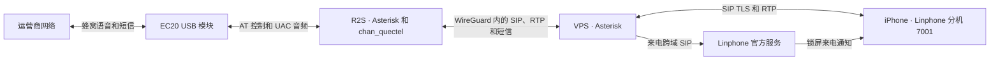

# 用 NanoPi R2S 和 Quectel EC20 搭建蜂窝转 SIP 网关

这份教程适合能用 SSH、改配置文件、读日志的读者。完成后，EC20 上的 SIM 负责蜂窝接打，iPhone 可用手机流量接打。Linphone 的官方账号负责锁屏来电，自己的 SIP 分机负责拨出和接收转发短信。短信达到设定阈值后，只清理已确认收到的旧短信。

香港本地 SIM 已实测来电、锁屏振铃、外拨、双向语音和短信接收转发。短信确认和清理顺序用测试数据验证，未把实际 SIM 填满。



## 1. 准备环境与参数

- NanoPi R2S，参考系统为 iStoreOS 24.10，CPU 为 ARM64。需有 Docker、WireGuard、USB 串口和 USB Audio 内核驱动。安装内核模块时要匹配当前固件的内核版本。
- Quectel EC20 USB 模块、支持语音和短信的 SIM 卡、稳定供电。参考设备的原始料号为 `EC20CEHCLG-128-AUD`，实测固件报告 `EC20CEFHLGR06A13M1G`。此处仅记录测试条件，不提供刷机步骤或固件。
- 一台有公网入口的 VPS。参考系统 Ubuntu 24.04、Asterisk 20。R2S 无需公网地址。
- 自有 SIP 域名和有效 TLS 证书，以及 iPhone 上的 Linphone。

下列为示例值。保留私网设计也可以，但先确认网段分别不与 VPS、路由器和 Docker 已有网段冲突。

| 参数 | 示例 |
|---|---|
| R2S 局域网地址 | `192.168.88.1` |
| R2S 容器内地址 | `172.30.77.2/24` |
| VPS 公网 IP 和域名 | `203.0.113.10`、`sip.example.net`，均需替换 |
| VPS 网卡地址和网段 | `10.0.0.10/24`，需替换。独立公网网卡可用其实际地址 |
| WireGuard 两端 | VPS `10.77.38.1`，R2S `10.77.38.2` |
| 局域网分机 / 外网分机 | `1001` / `7001`，各自设独立随机密码 |
| 内部来电路由 / 回音测试 | `7000` / `609` |

VPS 安全组只需为这套功能增开 `5061/TCP`（SIP TLS）、`12000–12049/UDP`（公网 RTP）和 `51820/UDP`（WireGuard）。保留自己的 SSH 规则。不要把 `5060/UDP`、`5038/TCP` 或 `8765/TCP` 开到公网。TLS 用于 SIP 信令，本例公网 RTP 没有启用 SRTP。

## 2. 确认 EC20 串口、SIM 和 UAC

在 R2S 主机执行：

```sh
lsusb
ls -l /dev/ttyUSB* /dev/cdc-wdm* /dev/snd
cat /proc/asound/cards
```

测试设备 USB ID 为 `2c7c:0125`，`/dev/ttyUSB2` 是 AT 口。端口编号可能因设备或插拔顺序改变。用 `picocom -b 115200 /dev/ttyUSB2` 或其他串口工具确认：

```text
AT
ATI
AT+CPIN?
AT+CEREG?
AT+CREG?
AT+COPS?
AT+QNWINFO
AT+QCFG="usbcfg"
```

`CPIN: READY` 表示 SIM 已就绪。注册状态常见的 `1` 为本地注册，`5` 为漫游注册。LTE 注册成功后仍要实测语音，不能只看信号或数据注册。

**先保存现有 USB 配置。** 只有在该固件确认支持 UAC、且查询得到的参数顺序和下例相同的情况下，才把最后一个音频开关由 `0` 改成 `1`。其余位保持设备原值：

```text
示例原值：AT+QCFG="usbcfg",0x2C7C,0x0125,1,1,1,1,1,0,0
示例新值：AT+QCFG="usbcfg",0x2C7C,0x0125,1,1,1,1,1,0,1
```

按模组文档重启后，重新核对串口编号和声卡。参考系统显示 `Android`，采集、播放设备分别是 `pcmC0D0c` 和 `pcmC0D0p`，格式为 8 kHz 单声道 S16_LE。该设备在通话时需要 `AT+QPCMV=1,2`，后续由驱动处理。改错 USB 位可能让 AT 口消失，因此应先准备恢复方式。

退出串口工具，再启动语音容器。一个 AT 串口同一时间只应由一个程序控制。此前装过 VoCat 或 ModemManager 的，先通过各自服务管理器停掉对该模块的占用。短信阶段通过独立 QMI 设备读取，无需重开 VoCat。

## 3. 编译并部署修补后的语音驱动

参考驱动使用 [chan_quectel 固定提交](https://github.com/IchthysMaranatha/asterisk-chan-quectel/commit/3d45c7f072131296a7e3c1a4faf5bb18751dbd87) 和 Asterisk 16。不同 Asterisk 主版本的模块不能混用。先在另一台能构建 ARM64 镜像的机器编译，或在 R2S 上单进程编译。参考 R2S 内存为 1 GB，边运行旧容器边并行编译会造成严重内存和磁盘压力。

从本仓库根目录执行：

```sh
docker buildx build --platform linux/arm64 --load \
  -f examples/Dockerfile -t local/ec20-sip:16-uac .
```

若 R2S 的 Docker 没有 Buildx，在 ARM64 的 R2S 上可用 `docker build -f examples/Dockerfile -t local/ec20-sip:16-uac .`。如果在另一台机器构建，用 `docker save` / `docker load` 移到 R2S。Dockerfile 使用 Debian Bullseye 的归档仓库，目的是复现已测试过的旧驱动组合。用于长期部署前，应评估支持周期和迁移到受维护版本的计划。

[驱动补丁](patches/chan-quectel-ec20-uac.patch)处理了几个实测故障：

| 现象 | 修正 |
|---|---|
| 来电接通后 Linphone 听不到对方 | 接听命令成功后推进通话状态，启动 UAC 采集，包括 ALSA 已处于 prepared 状态的情况 |
| 挂断后仍显示振铃，后续来电不响 | 收到挂断通知后重新查询通话列表，保留当前有效来电并清理已经结束的记录 |
| 外拨画面一闪就退出 | 在 EC20 给外拨分配正式通话编号前保护仍在初始化的通话 |
| 对方已接听，拨出端仍转圈 | 在外拨尚未接通时约每秒查一次 `AT+CLCC`，识别到接通后停止 |

日志里的 `+CLCC` 要区分语音和数据。参考设备经常有一个 `mode=1` 的数据会话，它不代表还有语音通话。

### 容器配置

把 [R2S 示例配置](examples/r2s/)复制到 `/opt/cellular-sip/etc`，修改局域网 IP、分机密码、串口和声卡。把配置设为容器内 `asterisk` 用户可读。可用下列命令确认镜像内 UID/GID，目录权限可用 `750`、文件 `640`，属组设为查到的 GID：

```sh
docker run --rm --entrypoint id local/ec20-sip:16-uac asterisk
```

逐一确认下面的设备节点。使用声卡和串口实际的属组号，避免给容器整个 `/dev` 或使用 `--privileged`。

```sh
AST_UID=$(docker run --rm --entrypoint id local/ec20-sip:16-uac -u asterisk)
AST_GID=$(docker run --rm --entrypoint id local/ec20-sip:16-uac -g asterisk)
chgrp -R "$AST_GID" /opt/cellular-sip/etc
chmod 750 /opt/cellular-sip/etc
chmod 640 /opt/cellular-sip/etc/*.conf
docker network create --subnet 172.30.77.0/24 cellular-sip-net
docker run -d --name cellular-sip --restart unless-stopped \
  --network cellular-sip-net --ip 172.30.77.2 \
  --user asterisk \
  --group-add "$(stat -c %g /dev/ttyUSB2)" \
  --group-add "$(stat -c %g /dev/snd/pcmC0D0c)" \
  --cap-drop ALL --security-opt no-new-privileges \
  --device /dev/ttyUSB2 --device /dev/ttyUSB1 \
  --device /dev/snd/controlC0 --device /dev/snd/pcmC0D0c --device /dev/snd/pcmC0D0p \
  -p 192.168.88.1:5060:5060/udp \
  -p 192.168.88.1:10000-10099:10000-10099/udp \
  --tmpfs "/var/run/asterisk:uid=$AST_UID,gid=$AST_GID,mode=0750" \
  -v /opt/cellular-sip/etc:/etc/asterisk:ro \
  local/ec20-sip:16-uac
```

如果容器报 `Permission denied`，核对串口和声卡节点、配置目录与 Asterisk 运行目录的属组。示例用 tmpfs 给 Asterisk 的运行目录提供可写空间。若验证时锁不住设备，核对是否有别的服务同时打开 AT 口。

```sh
docker exec cellular-sip asterisk -rx 'module show like chan_quectel'
docker exec cellular-sip asterisk -rx 'quectel show devices'
docker exec cellular-sip asterisk -rx 'pjsip show contacts'
```

若 Docker 自动创建了其他路由或防火墙规则，以 `nft list ruleset` 和实际测试为准。确认 R2S 的 WAN 侧无法访问上述 LAN SIP 入口。

先让局域网客户端用 `1001`、UDP、R2S 的 LAN 地址和 `5060` 登录。拨 `600` 做回音测试，再验证蜂窝接打。VPS 未部署时，入站并行呼叫中的 VPS 分支可能报不可达，局域网分支仍可接听。

## 4. 在 VPS 和 R2S 之间建立 WireGuard

在 Ubuntu VPS 安装：

```sh
sudo apt update
sudo apt install --no-install-recommends asterisk wireguard-tools
sudo modprobe wireguard
```

双方分别用 `umask 077; wg genkey > private.key; wg pubkey < private.key > public.key` 生成密钥。只交换公钥。把 VPS 的私钥和 R2S 公钥填入权限为 `600` 的 `/etc/wireguard/wg-sip.conf`：

```ini
[Interface]
Address = 10.77.38.1/30
ListenPort = 51820
PrivateKey = REPLACE_VPS_PRIVATE_KEY

[Peer]
PublicKey = REPLACE_R2S_PUBLIC_KEY
AllowedIPs = 10.77.38.2/32, 172.30.77.2/32
```

```sh
sudo systemctl enable --now wg-quick@wg-sip
sudo wg show wg-sip latest-handshakes
ip route get 172.30.77.2
```

若启动报 `Unknown device type`，先验证 `modprobe wireguard`，并用 systemd 的 `ExecStartPre=/usr/sbin/modprobe wireguard` 确保重启时会加载。公共云控制台要放行 `51820/UDP`。

用 LuCI 或 UCI 在 R2S 创建 `wgsip` 接口，隧道地址 `10.77.38.2/30`；对端写 VPS 公钥、IP 和 `51820`。Allowed IPs 只设 `10.77.38.1/32`，开启路由并设置 `PersistentKeepalive=25`。不要将默认路由指向此隧道。防火墙新建独立区并限制转发：

| 方向 | 放行范围 |
|---|---|
| VPS → R2S 容器 | 来源 `10.77.38.1`、目的 `172.30.77.2`，UDP `5060` 和 `10000–10099` |
| R2S 容器 → VPS | 来源 `172.30.77.2`、目的 `10.77.38.1`，UDP `5060` 和 `12000–12049` |
| R2S 主机 → VPS | 通过隧道 TCP `8765`，只在启用短信服务后使用 |

可参考 [OpenWrt 网络片段](examples/r2s/wireguard.uci.example) 和 [防火墙片段](examples/r2s/firewall.uci.example)。先备份 `/etc/config/network` 和 `/etc/config/firewall`，把片段合并后执行 `fw4 check`。使用 lan 端的 SSH 会话执行 `ubus call network reload` 与 `/etc/init.d/firewall reload`。

确认 R2S 开启 IPv4 forwarding，VPS 的容器单地址路由走隧道。跨境线路和境内线路要分别测。握手失败先核对公网 UDP、安全组、公钥和系统时钟。

## 5. 在 VPS 配置 SIP TLS 与 Linphone

1. 用自己的域名申请可信证书。将证书和私钥安装到 `/etc/asterisk/tls/`，私钥仅给 root 和运行 Asterisk 的组读取。如果用 Certbot，可参考 [续期脚本](examples/vps/certbot-sip-deploy.sh)。替换域名后，以可执行文件安装到 `/etc/letsencrypt/renewal-hooks/deploy/`。首次可在加载 Asterisk 前用 `sudo env RENEWED_LINEAGE=/etc/letsencrypt/live/你的域名 脚本绝对路径` 运行一次。续期后脚本会等通话结束再重启 Asterisk。
2. 将 [VPS 的 PJSIP、拨号计划、RTP 配置](examples/vps/)安装到 `/etc/asterisk/`。替换示例公网 IP、网卡地址、域名、分机密码和 Linphone 官方用户名。Asterisk 应在 WireGuard 接口就绪后启动，把 [启动顺序示例](examples/vps/asterisk-wg.conf) 放入 `/etc/systemd/system/asterisk.service.d/sip-wg.conf`，执行 `systemctl daemon-reload`。
3. 关闭不使用的通道和管理接口。可在 `modules.conf` 禁用 `chan_sip.so`、`chan_iax2.so`、`chan_mgcp.so`、`chan_skinny.so`，并在 `http.conf` 设置 `enabled=no`。短信阶段才启用示例中的本机 AMI。
4. 启动 Asterisk。核对 `pjsip show transports`、`pjsip show contacts`。应看到公网入口对应的 TLS `5061`，隧道地址上的 UDP `5060`，以及可达的 `r2s` 联系人。
5. iPhone 添加两个账号。以 Linphone 官方个人账号接听锁屏来电。再添加第三方分机 `7001`，用户名和认证 ID 都是 `7001`，SIP 代理用 `sip:sip.example.net:5061;transport=tls`。用 `7001` 选择拨出，官方账号接收经 VPS 转发的蜂窝来电。

手机关 Wi-Fi 后，先拨 `609`。有回音说明手机经公网、VPS 与 WireGuard 到 R2S 的双向 RTP 都通，且没有拨出运营商电话。再测手机号外拨、接听、双方声音和连续挂断重拨。锁屏几分钟后用另一部电话拨 SIM 号码。首次测试失败，先分别看 VPS CDR 的接听状态、R2S 的 `quectel show devices` 和 RTP 地址，再调整 UAC。

香港号码规则仅为示例，请按实际需要收窄。迁移到大陆时，VPS 和 R2S 两边都要加入同一套允许拨出的号码规则。例如大陆手机号可用 `_1[3-9]XXXXXXXXX`，`+86` 在 VPS 去掉前缀后使用同一规则。固定电话按实际区号和位数增补，避免用任意号码的通配规则。

## 6. 把收到的短信转发给 7001

运营商短信在 SIM 上，Linphone 看到的是经 SIP 投递的聊天消息。该方案不会启用运营商短信发送。第三方分机 `7001` 在线才能接收，离线时等下次上线；Linphone 官方账号不会收到这些短信。分机默认只允许一台设备注册，第二台登录会替换原注册。

保持 R2S `quectel.conf` 的 `disablesms=yes`。这个历史驱动记录过长短信接收导致崩溃的情况。使用 R2S 的 `uqmi` 通过 `/dev/cdc-wdm0` 读取，不并行操作 Asterisk 占用的 AT 口：

```sh
uqmi -d /dev/cdc-wdm0 -t 4000 --storage sim --list-messages
uqmi -d /dev/cdc-wdm0 -t 4000 --storage me --list-messages
```

上面的命令只列索引。调试时不要把 `--get-message` 的输出贴到公开日志或 Issue。

### VPS

- 将 [AMI 示例](examples/vps/manager.conf) 装到 `/etc/asterisk/manager.conf`，替换密钥。同一随机密钥单独保存为 `/etc/asterisk/sms-relay.secret`，权限 `600`，所有者 root。AMI 仅监听 `127.0.0.1:5038`，账号仅授予 `message` 写权限。
- 将 [relay.py](examples/relay.py) 安装到 `/opt/sip-sms-relay/relay.py`。改脚本中的示例域名，若隧道地址变更也要更新 `BIND`、`PEER`。服务只在 WireGuard 地址 `10.77.38.1:8765` 上监听，并校验来源。HTTP 内容在 WireGuard 加密隧道里传输。
- 安装 [确认处理脚本](examples/sip-sms-ack.py) 到 `/usr/share/asterisk/agi-bin/sip-sms-ack.py`（路径以 `asterisk -rx 'core show settings'` 为准），设为可执行。创建权限为 `700`、属主为 `asterisk` 的 `/var/lib/sip-sms-relay/pending` 和 `confirmed` 两个目录。
- 安装 [systemd 单元](examples/vps/sip-sms-relay.service)，执行 `systemctl daemon-reload`、`asterisk -rx 'manager reload'`、`systemctl enable --now sip-sms-relay`。确认示例中 `7001` 的 `message_context` 和 `[from-7001-sms]` 已加载。

```sh
sudo ss -lnt | grep -E ':5038|:8765'
sudo asterisk -rx 'pjsip show endpoint 7001'
sudo systemctl is-active sip-sms-relay
```

### R2S

安装 [sms-forward.sh](examples/sms-forward.sh) 到 `/opt/cellular-sip/sms-forward.sh`（权限 `700`），安装 [procd 启动脚本](examples/sip-sms-7001.init) 到 `/etc/init.d/sip-sms-7001`（权限 `755`）。修改 QMI 设备或隧道地址时也同步脚本。然后执行：

```sh
sh -n /opt/cellular-sip/sms-forward.sh
/etc/init.d/sip-sms-7001 enable
/etc/init.d/sip-sms-7001 start
logread -e sip-sms-7001
```

先让 `7001` 在线，发一条不含验证码的普通短信到 SIM 测试是否出现在 **R2S SMS** 聊天。转发程序不主动记录正文。Linphone 聊天历史本身会保存消息。如果开启 SIP 原始报文调试，可能记录正文，正常运行时应关闭。

## 7. 达到 30 条时清理已确认短信

EC20 的 `AT+CPMS?` 可查询 SIM 的使用量。本例实际容量为 40 条。收到转发短信后，在 **R2S SMS** 原样回复短信末尾的 `ACK <确认编号>`。这是送达确认，不会发出运营商短信。

- VPS 只从经过认证的 `7001` 接收确认，并把确认绑定到具体短信。
- R2S 只在 SIM 占用达到 30 时清理。按短信时间从旧到新，删到 29 条即停止。没有足够已确认的短信就保留原件。
- 删除前按当前索引重新读取并核对内容指纹，防止索引变化导致误删。发送入队、分机在线和 HTTP 成功都不等于已确认。没有确认编号的历史短信留存。
- 示例按单条消息实现，长短信分段、SIM 更换、存储容量变化和不同运营商行为需另测。脚本只接受 `SM` 存储且容量为 40 的 `CPMS` 结果。更换 SIM 或模组后重新核对 `CPMS`；如容量变化，按实际值修改解析条件和门槛，再启用清理。

建议用虚拟数据或空闲测试 SIM 验证这条规则，不用堆真实验证码来测试存满。停用时在 R2S 执行 `/etc/init.d/sip-sms-7001 stop` 和 `disable`，并在 VPS 停用 `sip-sms-relay`，还原短信启用前的 `manager.conf`、消息上下文和拨号规则。保留联系人和设备记录时也应控制备份访问权限。

## 8. 迁移和发布前检查

迁移到另一台 R2S 时单独备份容器镜像、Asterisk 配置、补丁、设备映射和 WireGuard 配置。不要将私钥通过公开仓库转移。新设备使用新密钥，然后在 VPS 更新 peer。两台 R2S 的容器地址相同且处于并行使用时，需改成不重叠的容器地址与路由。移机时先断开 USB 模块供电，再换 SIM 和接线。

发布前只上传本目录，不上传整份工作区或生产备份。核对域名、公网 IP、账号名、私钥、API 密钥、IMEI、IMSI、ICCID、短信正文和可识别日志。本目录中的 `REPLACE_...` 都是占位符。

### 参考

- [Quectel EC20 AT Commands Manual](https://fw.gl-inet.com/download/mifi/Quectel_EC20_AT_Commands_Manual_V1.0.pdf)
- [WireGuard 快速配置](https://www.wireguard.com/quickstart/)
- [Asterisk PJSIP NAT 配置](https://docs.asterisk.org/Configuration/Channel-Drivers/SIP/Configuring-res_pjsip/Configuring-res_pjsip-to-work-through-NAT/)
- [Asterisk AMI MessageSend](https://docs.asterisk.org/Latest_API/API_Documentation/AMI_Actions/MessageSend/)
- [Linphone 账号、推送与 SIP 聊天说明](https://www.linphone.org/en/faq/)
- [OpenWrt uqmi 短信实现](https://github.com/openwrt/uqmi/blob/master/uqmi/commands-wms.c)

驱动补丁以所附 [上游许可](patches/LICENSE.upstream.txt)为准。
